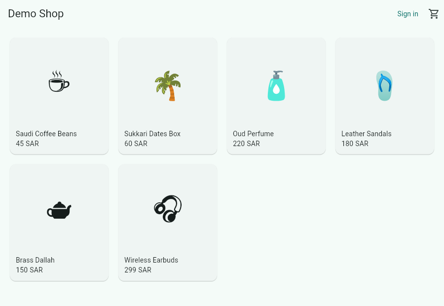
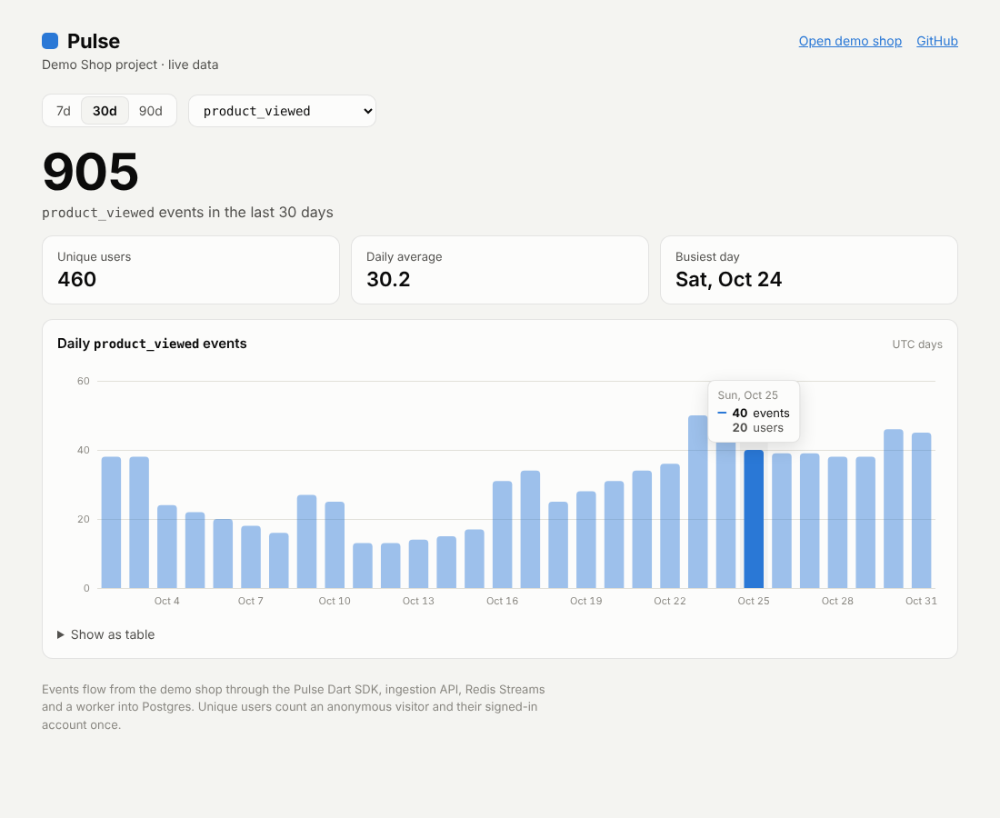
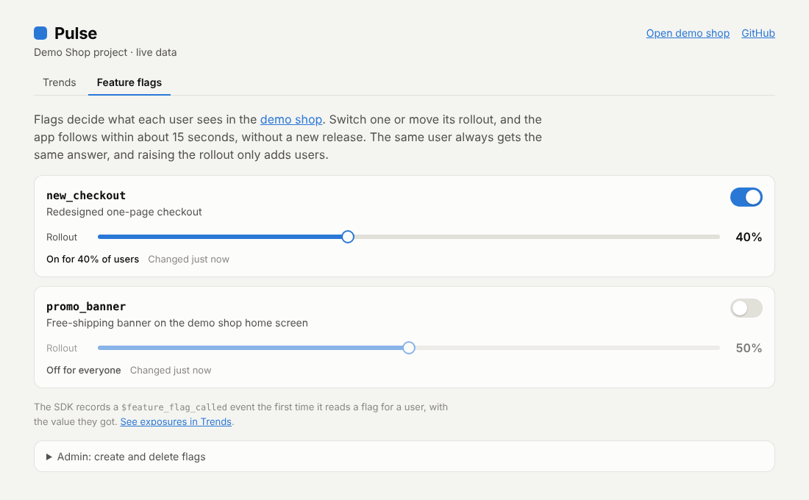

# Pulse

Product analytics and feature flags for mobile and web apps. Flutter-first,
Arabic-ready, built to host data in Saudi Arabia.

> **Live demo:** [sulaimanmokhaniq.github.io/pulse](https://sulaimanmokhaniq.github.io/pulse/) · **Dashboard:** [pulse-dashboard-eta-snowy.vercel.app](https://pulse-dashboard-eta-snowy.vercel.app/) · **Live API:** [pulse-api-udhc.onrender.com/health](https://pulse-api-udhc.onrender.com/health) (free tier; the first request may take up to a minute)
>
> Status: Phase 1 complete, feature flags added. Tap around the demo shop, then
> watch your events show up in the dashboard, or switch the `promo_banner` flag
> on the [Feature flags](https://pulse-dashboard-eta-snowy.vercel.app/flags) page
> and see the shop change.

## Architecture (Phase 1)

```
Flutter app ──▶ Dart SDK ──HTTP batch──▶ Ingestion API ──XADD──▶ Redis Stream ──▶ Worker ──────▶ PostgreSQL ──▶ Query API ──▶ Dashboard
               (batching,              (API-key auth,                           (consumer     (partitioned    (secret key)  (Next.js)
                offline queue)          validation, rate limit)                  group, dedup) events, daily
                                                                                               rollups)
```

The API never writes events to the database directly. It validates and
enqueues, then returns `202`. Bursts and short database outages don't slow
clients down. A worker drains the stream in batches and commits events,
person profiles and daily rollups in one transaction before acking. Every
event carries a `messageId`, so SDK retries and redeliveries are stored once.

| Path | What it is |
| --- | --- |
| `apps/api` | NestJS API: ingestion, queries and feature flags (TypeScript) |
| `packages/pulse_analytics` | Dart/Flutter SDK ([README](packages/pulse_analytics/README.md)) |
| `examples/demo_shop` | Flutter demo shop that uses the SDK ([README](examples/demo_shop/README.md)) |
| `apps/dashboard` | Next.js dashboard: trends and feature flags ([README](apps/dashboard/README.md)) |

## Quick look: the SDK

```dart
final pulse = await Pulse.init(PulseConfig(apiKey: 'pk_...', host: 'https://...'));
pulse.track('product_viewed', properties: {'productId': 'sku-1'});
pulse.identify('user-42', traits: {'plan': 'pro'});

if (pulse.isEnabled('new_checkout')) showNewCheckout();
```

Events are batched, persisted to disk while offline, and retried with
backoff. Every event carries a `messageId`, so the server stores it exactly
once however many times it's sent.



## The dashboard

Pick an event and a range (7, 30 or 90 days) to see daily counts and unique
users. Unique users count an anonymous visitor and their signed-in account
once. The chart works with hover, keyboard arrows, and a table view, and
follows the system dark mode.



## Feature flags

Turn a feature on for everyone, nobody, or a percentage of users, from the
dashboard, without shipping a new app version.

- **Sticky rollouts.** Each user's bucket is a hash of the flag key and their
  id, so they keep the same answer, raising the percentage only adds users,
  and different flags pick different users.
- **Fast and offline-safe on device.** The SDK fetches every flag for the user
  in one request and caches the result, so `isEnabled` never waits on the
  network.
- **Measurable.** The first read of a flag records `$feature_flag_called`
  with the value, ready for comparing the two groups.
- **Safe keys.** Apps evaluate flags with the write-only `pk_` key; changing
  them needs the `sk_` key, which only the dashboard server holds.

In the demo, anyone can switch a flag or move its rollout. Creating and
deleting flags needs an admin password.



## Run it locally

Requires Docker.

```bash
docker compose up --build -d
docker compose exec api node dist/db/seed-cli.js   # prints an API key once
```

Send an event:

```bash
curl -X POST http://localhost:3000/v1/batch \
  -H "Authorization: Bearer $PULSE_KEY" \
  -H "Content-Type: application/json" \
  -d '{
    "sentAt": "2026-10-23T12:00:00Z",
    "batch": [{
      "type": "track",
      "messageId": "6f1c7d0e-2b4a-4c55-9a1e-3d2f8b7c6a51",
      "event": "product_viewed",
      "distinctId": "anon-123",
      "properties": { "productId": "sku-1" },
      "timestamp": "2026-10-23T11:59:58Z"
    }]
  }'
# => {"accepted":1}
```

## Ingestion API

`POST /v1/batch`, authenticated with `Authorization: Bearer <key>` (or `x-api-key`).

| Field | Notes |
| --- | --- |
| `batch` | 1 to 100 events |
| `batch[].type` | `track` or `identify` |
| `batch[].messageId` | UUID generated by the SDK; makes retries idempotent |
| `batch[].event` | Required for `track` |
| `batch[].distinctId` | Anonymous id before identify, user id after |
| `batch[].userId`, `traits`, `properties`, `context` | Optional |
| `batch[].timestamp` | ISO 8601, when the event happened on the device |
| `sentAt` | Optional device time at send; used to correct clock skew |

Responses: `202` accepted, `400` invalid payload, `401` bad key, `413` body
too large, `429` rate limited (per API key).

`GET /health` checks Postgres and Redis.

## Query API

Authenticated with a secret `sk_` key. Ingest (`pk_`) keys can't read, and
secret keys can't ingest.

| Endpoint | Returns |
| --- | --- |
| `GET /v1/query/events` | Event names seen in the last 90 days, busiest first |
| `GET /v1/query/trends?event=<name>&days=7\|30\|90` | Total, unique users, and a zero-filled daily series |

## Flags API

| Endpoint | Key | Does |
| --- | --- | --- |
| `POST /v1/flags/evaluate` `{distinctId}` | `pk_` | Every flag resolved to `true`/`false` for that user |
| `GET /v1/flags` | `sk_` | List flags |
| `PUT /v1/flags/:key` `{enabled, rolloutPercent, description?}` | `sk_` | Create or replace a flag |
| `PATCH /v1/flags/:key` | `sk_` | Change some settings |
| `DELETE /v1/flags/:key` | `sk_` | Delete a flag |


## Design decisions

- **Queue before database.** Redis Streams absorb bursts and decouple
  ingestion from storage. The stream is capped (`MAXLEN ~`) so a stalled
  worker can't exhaust Redis memory.
- **Hashed API keys.** Only a SHA-256 hash is stored. Keys are high-entropy
  random strings, so a slow KDF isn't needed. Lookups are cached for 60s.
- **Clock-skew correction.** Offline events can be days old and device
  clocks drift, so the server shifts timestamps by `receivedAt - sentAt`.
- **Partitioned events table.** `events` is range-partitioned by time from
  day one, so retention becomes "drop a partition" and queries prune by date.
- **`project_id` everywhere.** Phase 1 runs a single project, but every
  table and key is already scoped, so multi-project support needs no
  migration.
- **Exactly-once storage on an at-least-once queue.** A message is acked only
  after its batch commits, so nothing is lost if the worker crashes;
  stale pending messages are reclaimed with `XAUTOCLAIM`. Duplicates are
  dropped by an `event_ids` ledger in the same transaction, and rollups count
  only newly inserted rows.
- **Rollups for charts.** `daily_event_counts` is maintained on write, so the
  trends chart reads a few hundred rows instead of scanning raw events.
- **Bad data doesn't block the queue.** Malformed messages go to a
  dead-letter stream. Timestamps more than a year old or a day ahead are
  clamped to the receive time, with the original kept in properties.
- **Cheap when idle.** The worker backs off to one poll every 30s while idle,
  and the API nudges it when events arrive, so latency stays under a second
  without spending the free Redis command quota.
- **Two kinds of key.** `pk_` keys ship inside apps and can only write.
  `sk_` keys can read and stay on servers: the dashboard calls the API from
  Next.js route handlers, so the key never reaches the browser.
- **12-factor config.** All connections come from env vars, so the same
  Docker image runs locally, on free hosting, or on a KSA VPS.

## Deploy

Free tier on Render, Neon, Upstash and Vercel: see [docs/deploy.md](docs/deploy.md).

## Development

```bash
cd apps/api
npm ci
cp .env.example .env   # point at local Postgres/Redis
npm test               # unit and e2e tests (needs Postgres and Redis)
```

## Roadmap

1. ✅ Ingestion API, schema, CI
2. ✅ Worker and storage, deployed on free tiers (Render, Neon, Upstash)
3. ✅ Dart SDK (`track`, `identify`, batching, offline queue) and demo shop
4. ✅ Trends dashboard (Next.js on Vercel)
5. ✅ Feature flags with percentage rollouts, in the API, SDK, dashboard and demo shop

Later: funnels and retention (with flag comparisons), A/B experiments, dashboard login and multiple projects, Arabic/RTL dashboard.

## License

MIT
