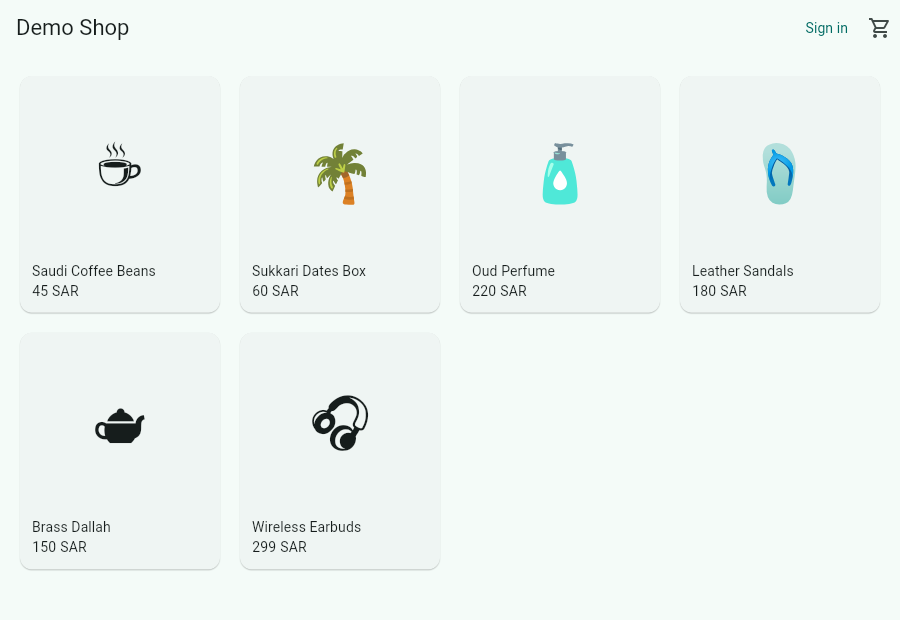

# Demo Shop

A small Flutter shop that uses the [`pulse_analytics`](../../packages/pulse_analytics)
SDK. It sends a realistic funnel to Pulse: `app_opened`, `product_list_viewed`,
`product_viewed`, `added_to_cart`, `cart_viewed`, `checkout_started` and
`purchase_completed`, plus `identify` on sign-in and `reset` on sign-out.



## Run

```bash
flutter pub get
flutter run -d chrome \
  --dart-define=PULSE_HOST=https://pulse-api-udhc.onrender.com \
  --dart-define=PULSE_KEY=pk_your_key
```

Use `-d android` or `-d ios` for a device or emulator. On mobile the offline
queue is stored on disk, so events tracked in airplane mode are sent on the
next launch.

The first request after the free API has been idle can take up to a minute
while it wakes up. The SDK keeps retrying, so nothing is lost.
